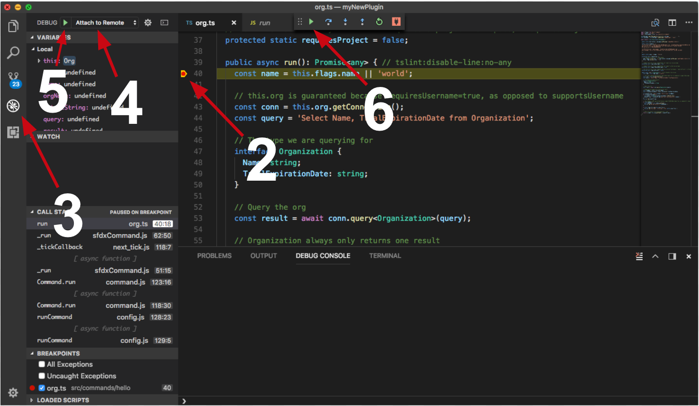

# testPlugin117

foo39

[](https://npmjs.org/package/testPlugin117)
[](https://circleci.com/gh/vmundra/testPlugin117/tree/master)
[](https://ci.appveyor.com/project/heroku/testPlugin117/branch/master)
[](https://greenkeeper.io/)
[](https://snyk.io/test/github/vmundra/testPlugin117)
[](https://npmjs.org/package/testPlugin117)
[](https://github.com/vmundra/testPlugin117/blob/master/package.json)

<!-- toc -->

- [testPlugin117](#testplugin117)
- [Debugging your plugin](#debugging-your-plugin)
  <!-- tocstop -->
    <!-- install -->
    <!-- usage -->

```sh-session
$ npm install -g @salesforce/test-plugin117
$ sfdx COMMAND
running command...
$ sfdx (--version)
@salesforce/test-plugin117/5.0.1 linux-x64 node-v22.23.3
$ sfdx --help [COMMAND]
USAGE
  $ sfdx COMMAND
...
```

<!-- usagestop -->
<!-- commands -->

- [`sfdx hello:org [FILE]`](#sfdx-helloorg-file)

## `sfdx hello:org [FILE]`

print a greeting and your org IDs

```
USAGE
  $ sfdx hello:org [FILE] -o <value> [--json] [--flags-dir <value>] [-n <value>] [-f] [-v <value>]
    [--api-version <value>]

FLAGS
  -f, --force                   example boolean flag
  -n, --name=<value>            name to print
  -o, --target-org=<value>      (required) Username or alias of the target org. Not required if the `target-org`
                                configuration variable is already set.
  -v, --target-dev-hub=<value>  Username or alias of the Dev Hub org.
      --api-version=<value>     Override the api version used for api requests made by this command

GLOBAL FLAGS
  --flags-dir=<value>  Import flag values from a directory.
  --json               Format output as json.

EXAMPLES
  sf hello org --target-org myOrg@example.com --target-dev-hub devhub@org.com

  sf hello org --name myname --target-org myOrg@example.com
```

_See code: [src/commands/hello/org.ts](https://github.com/salesforcecli/testPackageRelease/blob/5.0.1/src/commands/hello/org.ts)_

<!-- commandsstop -->
<!-- debugging-your-plugin -->

# Debugging your plugin

We recommend using the Visual Studio Code (VS Code) IDE for your plugin development. Included in the `.vscode` directory of this plugin is a `launch.json` config file, which allows you to attach a debugger to the node process when running your commands.

To debug the `hello:org` command:

1. Start the inspector

If you linked your plugin to the sfdx cli, call your command with the `dev-suspend` switch:

```sh-session
$ sfdx hello:org -u myOrg@example.com --dev-suspend
```

Alternatively, to call your command using the `bin/run` script, set the `NODE_OPTIONS` environment variable to `--inspect-brk` when starting the debugger:

```sh-session
$ NODE_OPTIONS=--inspect-brk bin/run hello:org -u myOrg@example.com
```

2. Set some breakpoints in your command code
3. Click on the Debug icon in the Activity Bar on the side of VS Code to open up the Debug view.
4. In the upper left hand corner of VS Code, verify that the "Attach to Remote" launch configuration has been chosen.
5. Hit the green play button to the left of the "Attach to Remote" launch configuration window. The debugger should now be suspended on the first line of the program.
6. Hit the green play button at the top middle of VS Code (this play button will be to the right of the play button that you clicked in step #5).
   <br><br>
   Congrats, you are debugging!
